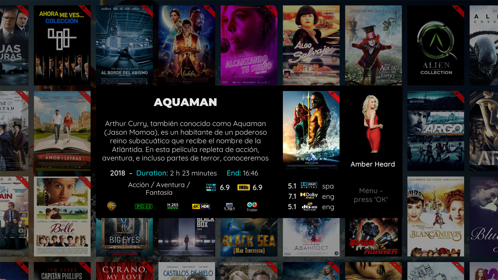

# Aeon Tajo Tweaked – Kodi 21 (Omega) Skin

**Aeon Tajo Tweaked** is an independent community fork of [Aeon Tajo](https://github.com/manfeed/skin.aeon.tajo) for **Kodi 21 (Omega)**. It keeps Aeon Tajo's artwork-focused home-cinema design while refining movie and TV views, episode information, navigation, and **Live TV/PVR infobars**.

[Install from Kodi Allen Repository](https://github.com/Kodi-Allen/kodi-repo#installation) · [Download version 1.0.0](https://github.com/Kodi-Allen/skin.aeon.tajo-tweaked/releases/download/v1.0.0/skin.aeon.tajo.tweaked-1.0.0.zip) · [Deutsche Beschreibung](README.de.md) · [Report an issue](https://github.com/Kodi-Allen/skin.aeon.tajo-tweaked/issues)

## Highlights

- Independent Kodi add-on: `skin.aeon.tajo.tweaked` can be installed alongside the original Aeon Tajo skin.
- Movie and TV artwork refinements, including clearlogos in the Flix view.
- Episode numbers formatted as `SxxExx`, cleaner headings, and improved runtime labels.
- Less visual noise from empty season metadata and episode statistics.
- Video information and media-case improvements, including a cached blur background helper.
- Live TV/PVR infobars that correctly separate one- to four-digit channel numbers from channel names.
- Standard and compact Live TV infobar layouts tested on Kodi 21.1.

The skin uses a 1920 × 1080, 16:9 layout. Remote-control or keyboard navigation is recommended; mouse control may not work correctly in every view.

## Screenshots

### Live TV and PVR on Kodi 21

Standard infobar | Compact infobar
--- | ---
 | 

Both screenshots were captured on Kodi 21.1 with a four-digit channel number. The channel number, channel name, station logo, programme information, and media icons remain separated.

### Movies, video information, and music

Movie library | Flix-style movie view
--- | ---
 | 

Video information | Music library
--- | ---
 | 

The bundled `resources/screenshot-*.jpg` files come from the Aeon Tajo base and illustrate its broader visual design. Views depend on library metadata, artwork, helper add-ons, and individual skin settings.

## Version and compatibility

| Branch | Add-on ID | Version | Status |
| --- | --- | --- | --- |
| [`omega`](https://github.com/Kodi-Allen/skin.aeon.tajo-tweaked/tree/omega) | `skin.aeon.tajo.tweaked` | 1.0.0 | Main release for Kodi 21 (Omega); tested on Kodi 21.1. |
| [`kodi22-leia-gui`](https://github.com/Kodi-Allen/skin.aeon.tajo-tweaked/tree/kodi22-leia-gui) | Legacy development identity | 7.7.4 | Experimental branch; not part of the 1.0.0 release and not a Kodi 22 compatibility guarantee. |

Version 1.0.0 is based on manfeed's Aeon Tajo 7.7.2 `omega` code line. The new name, add-on ID, and version series identify this maintained fork without replacing the original skin.

## Installation

### Kodi Allen Repository – recommended

Installing the repository enables normal Kodi add-on updates.

1. Download [`repository.kodiallen-1.0.1.zip`](https://raw.githubusercontent.com/Kodi-Allen/kodi-repo/main/repository.kodiallen/repository.kodiallen-1.0.1.zip).
2. In Kodi, open **Settings → System → Add-ons** and enable **Unknown sources** if required.
3. Open **Settings → Add-ons → Install from zip file** and select the repository ZIP.
4. Choose **Install from repository → Kodi Allen Repository → Look and feel → Skin → Aeon Tajo Tweaked**.
5. Select **Install**, then choose the skin when Kodi asks whether to switch.

### Direct ZIP installation

Download [`skin.aeon.tajo.tweaked-1.0.0.zip`](https://github.com/Kodi-Allen/skin.aeon.tajo-tweaked/releases/download/v1.0.0/skin.aeon.tajo.tweaked-1.0.0.zip) and install it through **Add-ons → Install from zip file**. Direct installations do not receive repository updates unless the Kodi Allen Repository is also installed.

Do not use GitHub's **Code → Download ZIP** archive as a Kodi add-on package; use one of the installable ZIP links above.

### Moving from the original Aeon Tajo

Aeon Tajo Tweaked uses its own add-on ID and does not overwrite `skin.aeon.tajo`. Both skins can remain installed, but Kodi stores their settings separately. Configure the Tweaked skin after switching, or back up and migrate settings manually if you understand Kodi's skin settings format.

## Required helper add-ons

| Add-on | Minimum version |
| --- | --- |
| `script.skinshortcuts` | 0.4.5 |
| `script.embuary.helper` | 2.0.6 |
| `script.skinvariables` | 2.1.14 |

Some optional information and artwork features also integrate with TMDb Helper (`plugin.video.themoviedb.helper`) and other helper add-ons. Their features require compatible versions and separate configuration.

## Live TV infobar fix in 1.0.0

The normal and compact PVR infobars reserve a dedicated area for channel numbers. Four-digit numbers such as `2001`, `2900`, and `9002` no longer collide with the channel name. Long channel names remain scrollable, and logo, codec, EPG, and clock positions are unchanged.

The fix was validated with XML parsing and tested visually on a Vero 4K+ running Kodi 21.1. Standard and compact layouts were tested while Live TV playback remained active.

## Support and contributions

[Open an issue](https://github.com/Kodi-Allen/skin.aeon.tajo-tweaked/issues) and include:

- Kodi version and operating system.
- Aeon Tajo Tweaked version and affected view.
- Reproduction steps, a screenshot, and relevant Kodi log lines.
- Confirmation whether the problem also occurs with the original Aeon Tajo skin.

Remove passwords, tokens, server addresses, and other private information before sharing logs.

## Credits and license

- **manfeed** — original [Aeon Tajo](https://github.com/manfeed/skin.aeon.tajo) skin and the 7.7.2 Omega base.
- **BigNoid** — Aeon Nox 5, credited as the original skin's inspiration.
- **frodo19** — movie genre icons, used with permission as recorded in `LICENSE.txt`.
- **Kodi-Allen** — Aeon Tajo Tweaked maintenance and distribution.
- The Kodi community and authors of the bundled fonts, artwork resources, and helper add-ons.

Aeon Tajo Tweaked is distributed under the [Creative Commons Attribution–NonCommercial–ShareAlike 4.0](https://creativecommons.org/licenses/by-nc-sa/4.0/) licence. See [`LICENSE.txt`](LICENSE.txt). Bundled components may have separate terms; preserve their notices.
