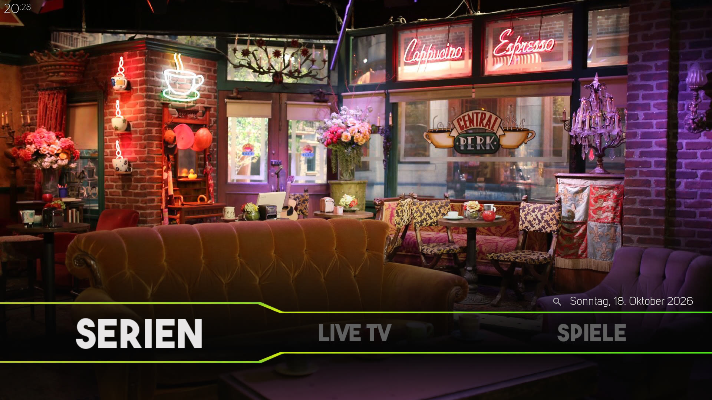
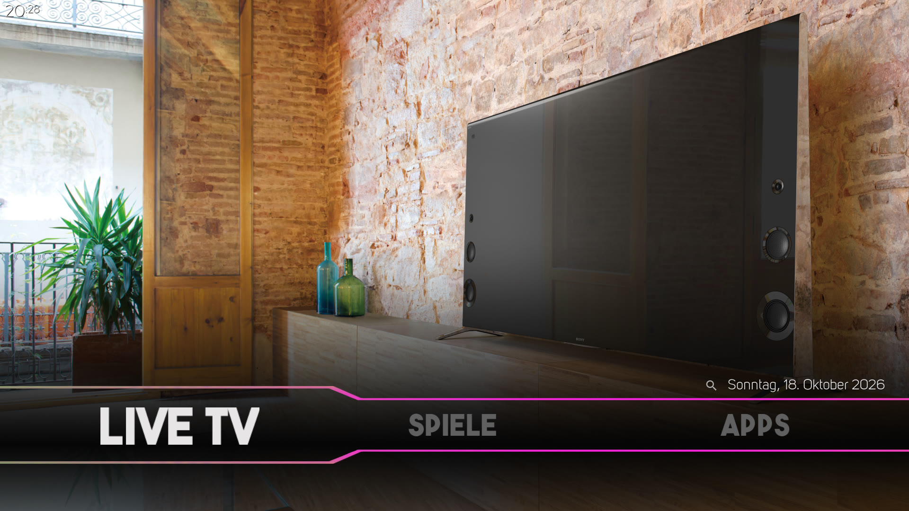
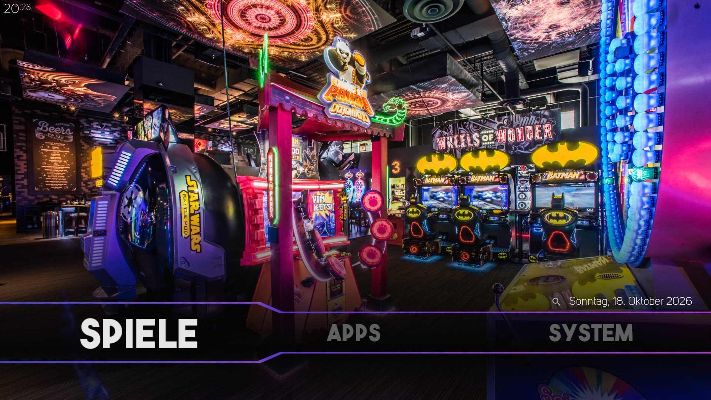
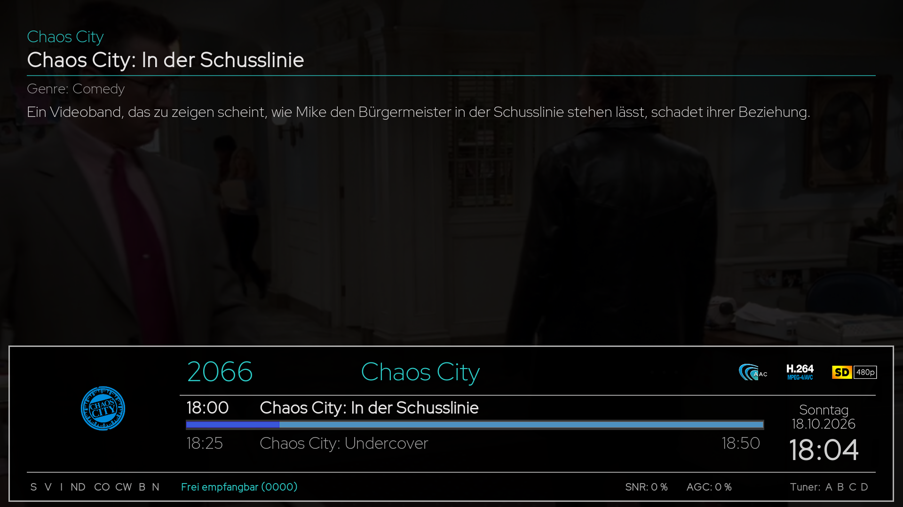
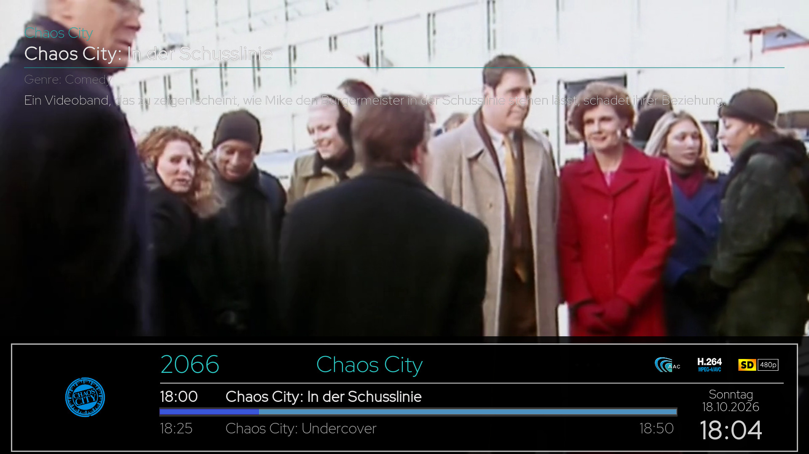

# Aeon Tajo Tweaked – Classic Leia Home Menu for Kodi 21 Omega

**Aeon Tajo Tweaked** brings the classic **Aeon Tajo Leia-style horizontal home menu** and its distinctive bold typography to **Kodi 21 (Omega)**. It is an independently installable community fork of [Aeon Tajo](https://github.com/manfeed/skin.aeon.tajo), combining the familiar Leia layout with the maintained Omega codebase.

[Install from Kodi Allen Repository](https://github.com/Kodi-Allen/kodi-repo#installation) · [Download version 1.0.1](https://github.com/Kodi-Allen/skin.aeon.tajo-tweaked/releases/download/v1.0.1/skin.aeon.tajo.tweaked-1.0.1.zip) · [Deutsche Beschreibung](README.de.md) · [Report an issue](https://github.com/Kodi-Allen/skin.aeon.tajo-tweaked/issues)

## Why this version exists

Current Aeon Tajo releases use a newer home-screen design. Aeon Tajo Tweaked keeps Kodi 21 Omega compatibility while restoring the older presentation many users prefer:

- Classic horizontal Aeon Tajo home menu from the Leia era.
- Original-style bold menu and title fonts, plus Kiye Sans widget headings.
- Category-specific home backgrounds and the familiar angled selection frame.
- Independent add-on ID `skin.aeon.tajo.tweaked`, so it can coexist with the original skin.
- Maintained movie, TV show, artwork, episode-information, and navigation refinements.
- Standard and compact Live TV infobars with correct spacing for one- to four-digit channel numbers.

The skin targets a 1920 × 1080, 16:9 interface. Remote-control or keyboard navigation is recommended.

## Screenshots from the maintained Kodi installation

TV shows | Live TV
--- | ---
 | 

Games | Four-digit Live TV channel number
--- | ---
 | 

Standard infobar | Compact infobar
--- | ---
 | 

These screenshots were captured directly from the maintained Vero 4K+ running Kodi 21.1. They show the restored home layout, typography, backgrounds, and the Live TV infobar used by this release. No third-party screenshots or personal library entries are included.

## Version and compatibility

| Release line | Add-on ID | Version | Compatibility |
| --- | --- | --- | --- |
| Aeon Tajo Tweaked | `skin.aeon.tajo.tweaked` | 1.0.1 | Kodi 21 Omega; tested on Kodi 21.1. |
| Original Aeon Tajo base | `skin.aeon.tajo` | 7.7.2 | Upstream Omega base used when the fork was created. |

Aeon Tajo Tweaked uses its own `1.x` version series. Version 1.0.1 includes the actively maintained Leia-style home-screen and font work that was previously developed separately. The historical `kodi22-leia-gui` branch is an integration source, not a separate Kodi 22 release or compatibility promise.

## Installation

### Kodi Allen Repository – recommended

Installing the repository enables normal Kodi add-on updates.

1. Download [`repository.kodiallen-1.0.1.zip`](https://raw.githubusercontent.com/Kodi-Allen/kodi-repo/main/repository.kodiallen/repository.kodiallen-1.0.1.zip).
2. In Kodi, open **Settings → System → Add-ons** and enable **Unknown sources** if required.
3. Open **Settings → Add-ons → Install from zip file** and select the repository ZIP.
4. Choose **Install from repository → Kodi Allen Repository → Look and feel → Skin → Aeon Tajo Tweaked**.
5. Select **Install**, then switch to the skin when Kodi asks.

### Direct ZIP installation

Download [`skin.aeon.tajo.tweaked-1.0.1.zip`](https://github.com/Kodi-Allen/skin.aeon.tajo-tweaked/releases/download/v1.0.1/skin.aeon.tajo.tweaked-1.0.1.zip) and install it through **Add-ons → Install from zip file**. GitHub's **Code → Download ZIP** archive is not a Kodi add-on package.

### Moving from the original Aeon Tajo

Aeon Tajo Tweaked does not overwrite `skin.aeon.tajo`. Both skins can remain installed, but Kodi stores their settings separately. Configure the Tweaked skin after switching, or migrate settings manually only if you understand Kodi's skin settings format.

## Required helper add-ons

| Add-on | Minimum version |
| --- | --- |
| `script.skinshortcuts` | 0.4.5 |
| `script.embuary.helper` | 2.0.6 |
| `script.skinvariables` | 2.1.14 |

Optional information and artwork features can also use TMDb Helper (`plugin.video.themoviedb.helper`) and other compatible helper add-ons.

## Four-digit Live TV channel numbers

The normal and compact PVR infobars reserve a dedicated area for channel numbers. Four-digit numbers such as `2001`, `2900`, and `9002` no longer collide with the channel name or logo. Long channel names remain scrollable, while codec, EPG, and clock positions remain unchanged.

## Support

[Open an issue](https://github.com/Kodi-Allen/skin.aeon.tajo-tweaked/issues) with the Kodi version, operating system, skin version, affected view, reproduction steps, a screenshot, and relevant Kodi log lines. Remove passwords, tokens, API keys, server addresses, private paths, and other personal information before sharing logs.

## Credits and licence

- **manfeed** — original [Aeon Tajo](https://github.com/manfeed/skin.aeon.tajo) skin and the 7.7.2 Omega base.
- **BigNoid** — Aeon Nox 5, credited as the original skin's inspiration.
- **frodo19** — movie genre icons, used with permission as recorded in `LICENSE.txt`.
- **Kodi-Allen** — Aeon Tajo Tweaked maintenance and distribution.
- The Kodi community and authors of the bundled fonts, artwork resources, and helper add-ons.

Aeon Tajo Tweaked is distributed under the [Creative Commons Attribution–NonCommercial–ShareAlike 4.0](https://creativecommons.org/licenses/by-nc-sa/4.0/) licence. See [`LICENSE.txt`](LICENSE.txt). Bundled components may have separate terms; preserve their notices.
