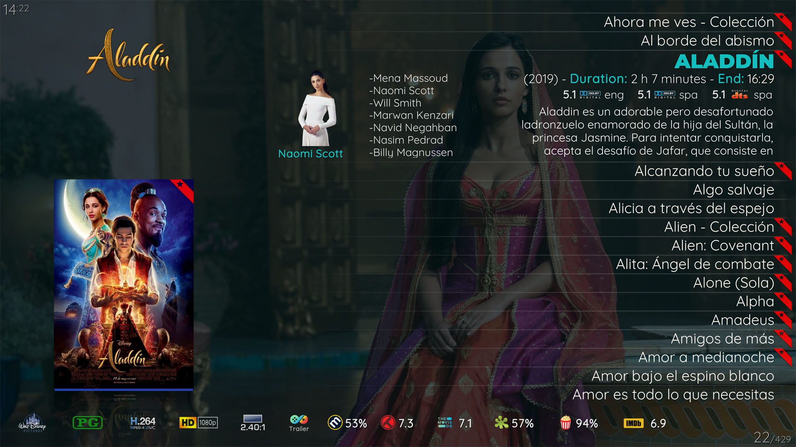

# Aeon Tajo Tweaked

**A community customization of [Aeon Tajo](https://github.com/manfeed/skin.aeon.tajo) for Kodi, with refinements to artwork, video information and episode browsing.**

Based on manfeed's `omega` branch, this project keeps Aeon Tajo's artwork-focused presentation and adds personal interface tweaks for a home cinema library.

[Download the Omega branch](https://github.com/Kodi-Allen/skin.aeon.tajo-tweaked/archive/refs/heads/omega.zip) · [Report an issue](https://github.com/Kodi-Allen/skin.aeon.tajo-tweaked/issues) · [Original Aeon Tajo](https://github.com/manfeed/skin.aeon.tajo)

*Included Aeon Tajo reference screenshot. These bundled images illustrate the original skin and may differ from the latest tweaks.*

## What is different?

The `omega` branch includes:

- TV show clearlogos in the Flix view, with episode titles kept visible.
- Episode numbers displayed as `SxxExx` and cleaner headers and runtime labels.
- Fewer empty season metadata and episode statistics labels.
- Video information and media case improvements, including a cached blur background helper.
- Small typography, list colour and parent-folder artwork refinements.

The skin uses a 1920 × 1080, 16:9 layout. Remote or keyboard navigation is recommended; mouse control may not work correctly in every view.

## Versions and compatibility

| Branch | Version in `addon.xml` | Purpose |
| --- | --- | --- |
| [`omega`](https://github.com/Kodi-Allen/skin.aeon.tajo-tweaked/tree/omega) | 7.7.2 | Default branch with the refinements described above; based on Kodi 21 / Omega skin requirements. |
| [`kodi22-leia-gui`](https://github.com/Kodi-Allen/skin.aeon.tajo-tweaked/tree/kodi22-leia-gui) | 7.7.4 | Alternate development branch for Leia-style interface work, font changes and localization fixes. |

These branches contain different changes; the alternate branch is not a complete replacement for `omega`.

Both currently declare `xbmc.gui` 5.17.0. Kodi's [current GUI manifest](https://github.com/xbmc/xbmc/blob/master/addons/xbmc.gui/addon.xml) retains compatibility with that ABI, but this alone does not establish full Kodi 22 support. **Kodi 22 compatibility needs runtime testing**, including the helper add-ons and the views you use. The branch name is not a compatibility guarantee.

## Installation

This repository provides source snapshots. Start with the `omega` branch unless you specifically want to test the alternate development branch.

**Existing Aeon Tajo users:** this customization keeps the original add-on ID, `skin.aeon.tajo`. Installing it replaces the existing Aeon Tajo skin rather than adding a separate skin. Back up your skin settings before switching.

1. [Download the Omega ZIP](https://github.com/Kodi-Allen/skin.aeon.tajo-tweaked/archive/refs/heads/omega.zip) to a location accessible to Kodi.
2. In Kodi, open **Settings → System → Add-ons** and enable **Unknown sources** if needed.
3. Open **Add-ons → Add-on browser → Install from ZIP file** and select the downloaded archive.
4. Allow Kodi to install the required helper add-ons. If a dependency cannot be satisfied, check that a compatible version is available for your Kodi version.
5. Select **Aeon Tajo** under **Settings → Interface → Skin**, then adjust the skin settings to suit your library.

For Kodi's installation walkthrough, see the [official add-on manager guide](https://kodi.wiki/view/Add-on_manager#How_to_install_from_a_ZIP_file). ZIP installations require manual updates unless an installed add-on repository supplies them.

### Required helpers

The current `addon.xml` declares these minimum versions:

| Add-on | Minimum version |
| --- | --- |
| `script.skinshortcuts` | 0.4.5 |
| `script.embuary.helper` | 2.0.6 |
| `script.skinvariables` | 2.1.14 |

Some optional information and artwork features also integrate with **TMDb Helper** (`plugin.video.themoviedb.helper`) and other helper add-ons. Those features depend on the relevant helper being installed and configured.

## More of the original look

More bundled reference images are available in [`resources/`](resources/). Artwork shown in screenshots is illustrative and is not supplied as a media library.

## Feedback and contributions

[Open an issue](https://github.com/Kodi-Allen/skin.aeon.tajo-tweaked/issues) for problems specific to this customization. Include:

- Your exact Kodi version, operating system and the branch you installed.
- The affected view and the steps needed to reproduce the problem.
- A screenshot and relevant Kodi log details, with personal information removed.

Improvements and test reports are welcome. For a proposed change, mention which branch it targets and which Kodi version you tested.

## Credits and license

- **manfeed** — original [Aeon Tajo](https://github.com/manfeed/skin.aeon.tajo) skin and the Omega base for this project.
- **BigNoid** — Aeon Nox 5, credited as the original skin's inspiration.
- **frodo19** — movie genre icons, used with permission as recorded in `LICENSE.txt`.
- **Kodi-Allen** — the customizations maintained in this repository.
- The Kodi community and the authors of the included fonts, artwork resources and helper add-ons.

The skin is licensed under **[Creative Commons Attribution–NonCommercial–ShareAlike 4.0](https://creativecommons.org/licenses/by-nc-sa/4.0/)**. See [`LICENSE.txt`](LICENSE.txt). Included components may have separate terms; preserve their notices, including those in [`fonts/`](fonts/) and the media resource directories.
